<div align="center">


# JUDGELS
    
[Sekilas Tentang](#sekilas-tentang) | [Instalasi](#instalasi) | [Maintenance](#maintenance) | [Otomatisasi](#otomatisasi-opsional) | [Cara Pemakaian](#cara-pemakaian) | [Pembahasan](#pembahasan) | [Referensi](#referensi)
:---:|:---:|:---:|:---:|:---:|:---:|:---:

</div>

---

# Sekilas Tentang
[`^ kembali ke atas ^`](#)

**Judgels** adalah platform open-source untuk pengelolaan competitive programming. Dikembangkan secara aktif oleh Ikatan Alumni Tim Olimpiade Komputer Indonesia (IA-TOKI), untuk perkembangan terbaru (termasuk versi terbaru/TLS) dapat dilihat di [repo resmi Judgels](https://github.com/ia-toki/judgels).

<details>
<summary>Judgels udah dipakai dimana saja?</summary>
    Judgels sudah dipakai pada beberapa kompetisi nasional, diantaranya:
<ol>
  <li>TLX, latihan CP (Competitive Programming) terbesar di Indonesia.</li>
  <li>Indonesian National Olympiad in Informatics sejak 2015.</li>
  <li>Asia-Pacific Informatics Olympiad 2015 & 2020, hosted by Indonesia.</li>
</ol>
</details>

<details>
<summary>Tipe soal apa saja yang didukung Judgels?</summary>
Judgels juga mendukung beberapa tipe soal yang lazim ditemui pada contest Competitive Programming:
  <ol>
    <li>Batch, dimana program peserta akan membaca input (bisa dengan <kbd>scanf()</kbd> maupun input lainnya sesuai dengan bahasa pemrograman) lalu program peserta akan mengeluarkan output yang akan disesuaikan dengan hasil dari juri/admin yang sudah disiapkan sebelumnya.</li>
    <li>Interactive, program peserta akan melakukan komunikasi bolak balik dua arah antara program peserta dengan program juri. Biasanya jenis soal yang digunakan adalah untuk menebak angka atau penelusuran graf tersembunyi. Dengan konsep bolak balik ini, program peserta wajib menggunakan flush (<kbd>fflush(stdout)</kbd> atau <kbd>cout << flush</kbd>).</li>
    <li>Output-Only, peserta hanya perlu memberikan file outputnya (misalkan dalam bentuk .txt maupun .out).
    <li>Functional / Grader, peserta hanya perlu membuat function sesuai dengan format yang sudah ditentukan dan akan mereturn jawaban yang sesuai. Yang memakai konsep ini salah satu contohnya adalah LeetCode.</li>
  </ol>
</details>

<details>
<summary>Bagaimana dengan mekanisme penilaiannya?</summary>
Selain mendukung banyak tipe soal, Judgels juga mendukung beberapa mekanisme penilaian:
  <ol>
    <li>Subtask, intinya adalah terdapat perbedaan poin pada setiap subtask/test case. Misal subtask 1 bernilai 20 poin, sedangkan subtask 2 bernilai 80 poin pada sebuah soal.</li>
    <li>Custom Checker, intinya adalah seluruh proses dari program peserta akan dicek, apakah sesuai dengan soal yang diminta atau tidak. Kalau terdapat salah satu saja yang tidak, maka untuk soal tersebut akan dinyatakan Wrong Answer (WA).</li>
  </ol>
</details>

<details>
<summary>Lalu, apa saja Format Kompetisi yang didukung Judgels?</summary>
Berdasarkan beberapa fitur/tipe yang didukung oleh Judgels, maka dapat disimpulkan Judgels juga mendukung beberapa Format Kompetisi, yaitu:
  <ol>
    <li>IOI (International Olympiad in Informatics), biasanya dipakai untuk siswa tingkat menengah (SMA atau OSN).</li>
      <ul>
        <li>Peserta berkompetisi secara individu.</li>
        <li>Penilaian berbasis poin per subtask (skor 0 hingga 100 per soal).</li>
        <li>Tidak ada sistem penalti waktu untuk wrong submission (hanya skor tertinggi per soal yang dihitung).</li>
        <li>Hasil penilaian biasanya langsung menampilkan rincian poin tiap subtask secara instan (live feedback).</li>
      </ul>
    <li>ICPC (International Collegiate Programming Contest), biasanya dipakai untuk mahasiswa perguruan tinggi.</li>
      <ul>
        <li>Peserta berkompetisi dalam tim yang terdiri dari 3 orang dengan hanya 1 komputer.</li>
        <li>Sistem penilaian bersifat biner: Accepted (AC) bernilai 1 soal, tidak ada nilai parsial/subtask.</li>
        <li>Menggunakan sistem penalti waktu: setiap submission yang salah sebelum akhirnya AC akan menambah penalti waktu (biasanya 20 menit per penolakan). Pemenang diurutkan berdasarkan jumlah soal terbanyak, lalu penalti waktu terkecil.</li>
      </ul>
  </ol>
</details>

# Instalasi
[`^ kembali ke atas ^`](#)

#### Kebutuhan Sistem :
- **Sistem Operasi**: Linux (disarankan Arch Linux / Ubuntu 22.04 / Debian 12+), macOS, atau Windows (dengan WSL2).
- **Docker Engine & Docker Compose**: Docker versi 24.0+ dengan plugin Docker Compose v2 (`docker compose`).
- **Spesifikasi Hardware**: Minimal RAM 4 GB+ dan 2 CPU Core (agar seluruh kontainer database MySQL, server Judgels, client frontend, dan grader berjalan lancar tanpa *out-of-memory*).
- **Storage**: Minimal 10 GB free storage untuk image Docker dan volume database.
- **Port Jaringan**: Port `5000` (Judgels Client) dan `9101` (Judgels Server API) harus kosong serta tidak terpakai oleh layanan lain di host.

---

#### Proses Instalasi :
Proses instalasi dan setup Judgels ini kami bagi menjadi 3 skenario yang bisa kalian ikuti secara berurutan sesuai kebutuhan:
- **[1. Instalasi Dasar Judgels di Lingkungan Lokal](#1-instalasi-dasar-judgels-di-lingkungan-lokal)**
- **[2. Backup Data Judgels Lokal & Migrasi (Push) ke Server VPS](#2-backup-data-judgels-lokal--migrasi-push-ke-server-vps)**
- **[3. Konfigurasi Domain & HTTPS (SSL Let's Encrypt)](#3-konfigurasi-domain--https-ssl-lets-encrypt)**

---

### 1. Instalasi Dasar Judgels di Lingkungan Lokal
[`^ kembali ke atas ^`](#)

Pada tahap awal ini, kita akan memasang *stack* Judgels lengkap (Database MySQL, RabbitMQ, Judgels Server, Judgels Client, dan Judgels Grader) langsung di komputer lokal kita.

1. Siapkan struktur direktori proyek `judgels` beserta folder `conf/`. Struktur folder dan file yang wajib ada adalah seperti pada gambar berikut:

    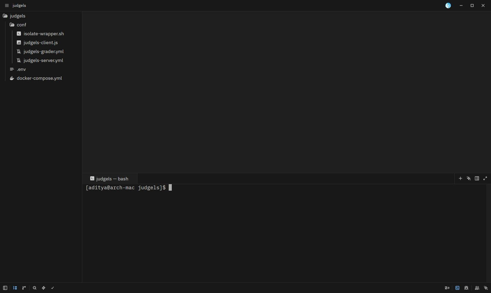

2. Buat file environment `.env` di dalam folder utama `judgels` untuk mendefinisikan konfigurasi password database MySQL, RabbitMQ, akun superadmin, serta port host:

    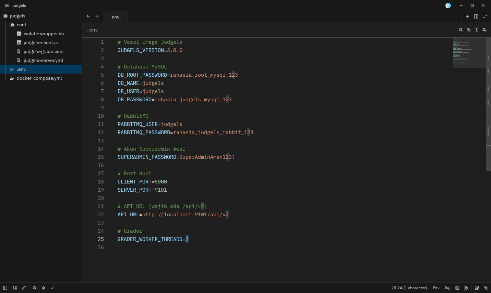

    ```bash
    # Versi image Judgels resmi
    JUDGELS_VERSION=3.0.0

    # 1. Database (MySQL 8.0)
    DB_ROOT_PASSWORD=rahasia_root_mysql_123
    DB_NAME=judgels
    DB_USER=judgels
    DB_PASSWORD=rahasia_judgels_mysql_123

    # 2. Message Broker (RabbitMQ)
    RABBITMQ_USER=judgels
    RABBITMQ_PASSWORD=rahasia_judgels_rabbit_123

    # 3. Akun Superadmin Awal
    SUPERADMIN_PASSWORD=SuperAdminAman123!

    # 4. Port Host
    CLIENT_PORT=5000
    SERVER_PORT=9101

    # 5. URL API untuk Frontend (wajib diakhiri /api/v2 pada image v3.0.0)
    API_URL=http://localhost:9101/api/v2

    # 6. Grader Setting (jumlah thread penilaian simultan)
    GRADER_WORKER_THREADS=2
    ```

3. Buat file konfigurasi `conf/judgels-server.yml` untuk mengatur koneksi database MySQL, RabbitMQ, *data directory*, dan pengaturan CORS:

    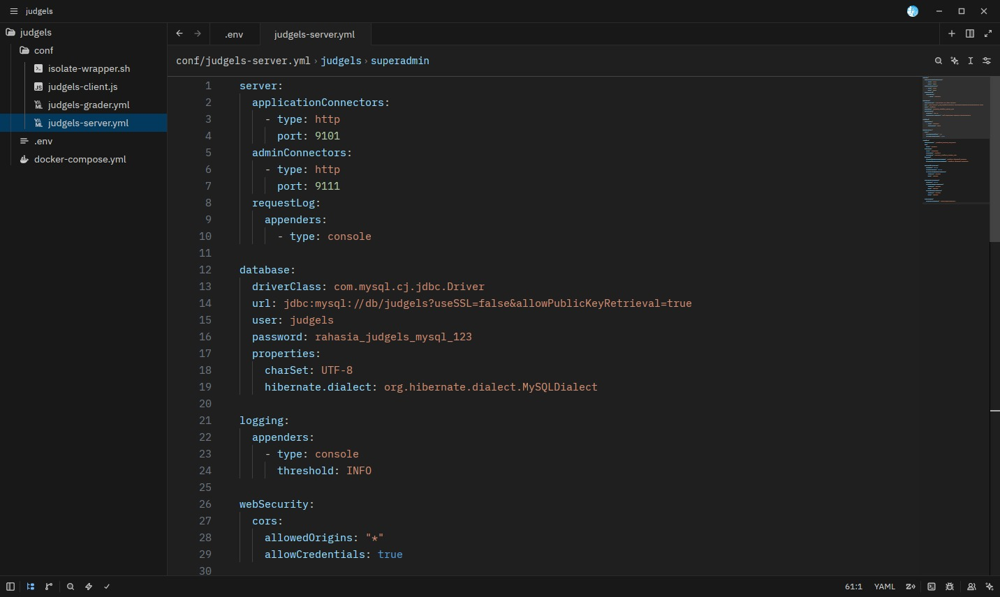

4. Buat file `conf/judgels-client.js` agar frontend React Judgels dapat menghubungi API backend server. Ingat ya, pada image client `3.0.0`, `apiUrl` wajib berakhiran `/api/v2`:

    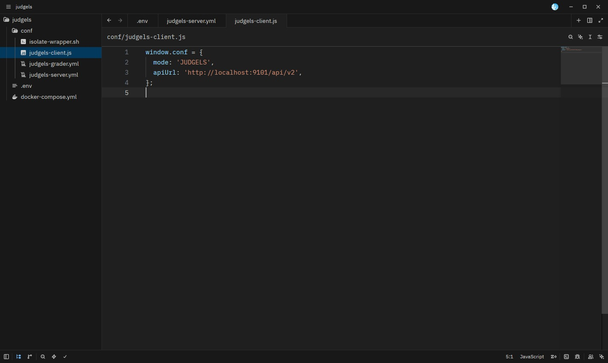

    ```javascript
    window.conf = {
      mode: 'JUDGELS',
      apiUrl: 'http://localhost:9101/api/v2',
    };
    ```

5. Buat file konfigurasi grader `conf/judgels-grader.yml` agar grader dapat terhubung ke queue RabbitMQ dan membaca data soal dari server:

    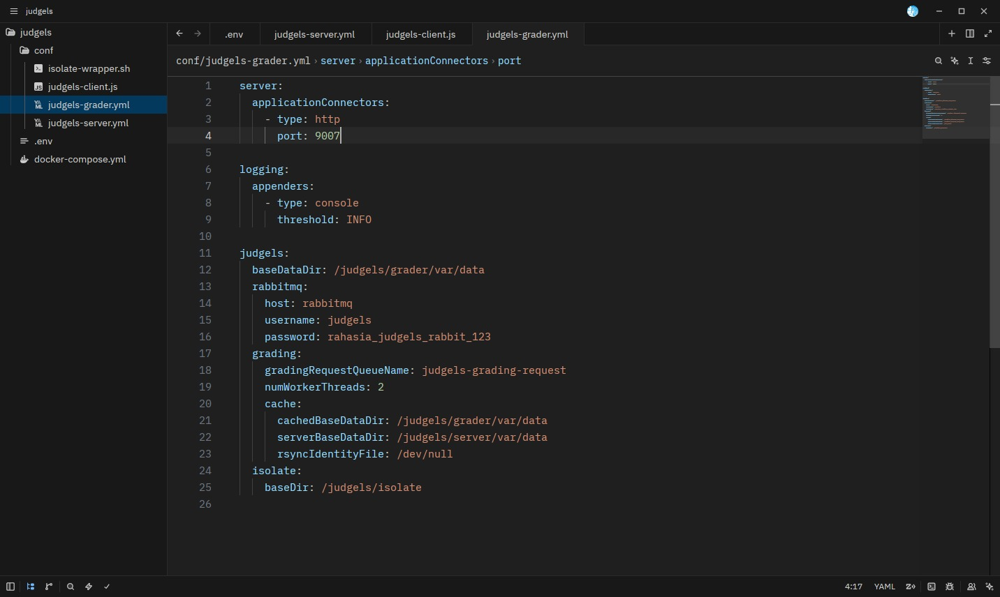

6. Siapkan skrip pembungkus `conf/isolate-wrapper.sh` untuk menjembatani eksekusi Isolate di dalam lingkungan Docker:

    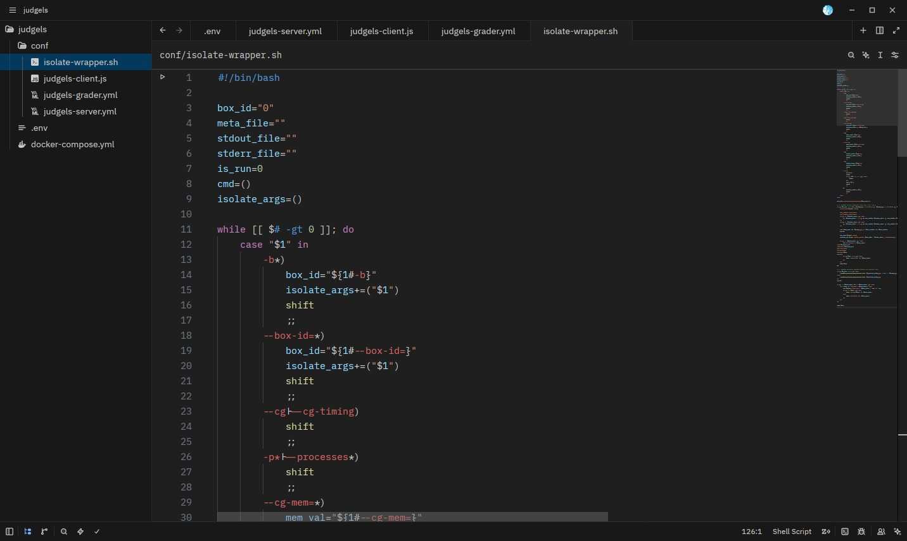

7. Jangan lupa berikan izin eksekusi (*executable*) pada file `conf/isolate-wrapper.sh` tersebut:
    ```bash
    $ chmod +x conf/isolate-wrapper.sh
    ```

    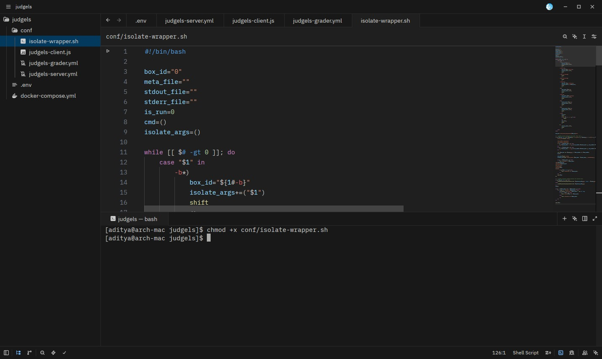

8. Buat file `docker-compose.yml` yang mengatur orchestration seluruh layanan: `db` (MySQL 8.0), `rabbitmq`, `judgels-server`, `judgels-client`, dan `judgels-grader`:

    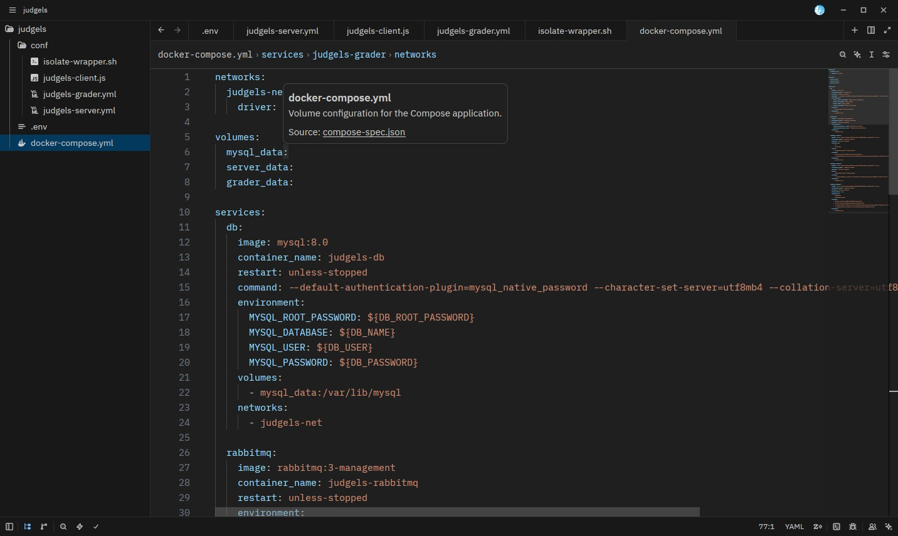

9. Jalankan kontainer database MySQL dan message broker RabbitMQ terlebih dahulu di latar belakang:
    ```bash
    $ docker compose up -d db rabbitmq
    ```

    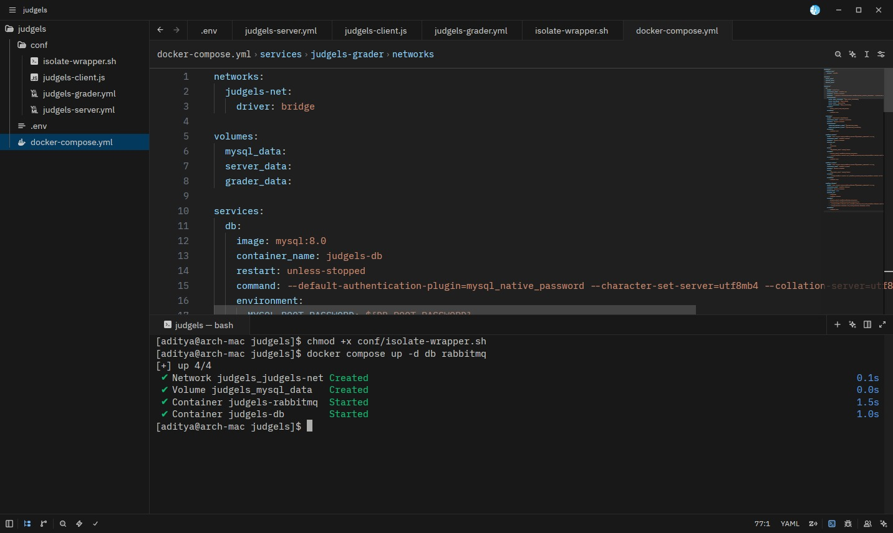

10. **Catatan Penting: Mengatasi Kendala Waktu Inisialisasi Database (Error Connection Refused)**  
    Ketika kita baru saja menjalankan `docker compose up -d db rabbitmq`, kontainer MySQL baru pertama kali dibuat dari volume kosong. MySQL membutuhkan waktu lebih lama sekitar 20-30 detik untuk inisialisasi direktori internal dan membuat file system-nya. Kalau kita langsung menjalankan migrasi database (`docker compose run --rm judgels-server db migrate`), maka akan muncul error `java.net.ConnectException: Connection refused` seperti pada gambar berikut:

    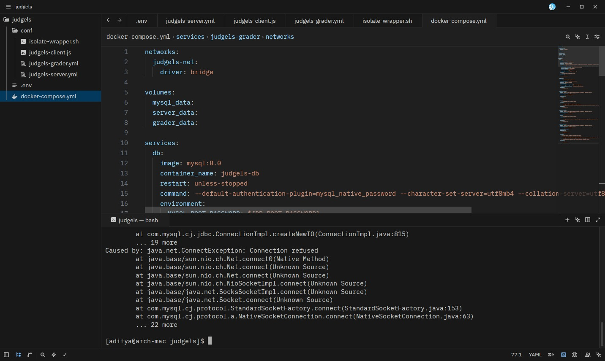

    Untuk mengatasinya gampang banget, kalian hanya perlu menunggu sekitar 20-30 detik sampai MySQL benar-benar siap, atau gunakan perintah berikut di terminal untuk menunggu secara otomatis sampai MySQL siap (*alive*):
    ```bash
    $ until docker exec judgels-db mysqladmin ping -u root -prahasia_root_mysql_123 --silent; do
        sleep 3
    done
    ```

    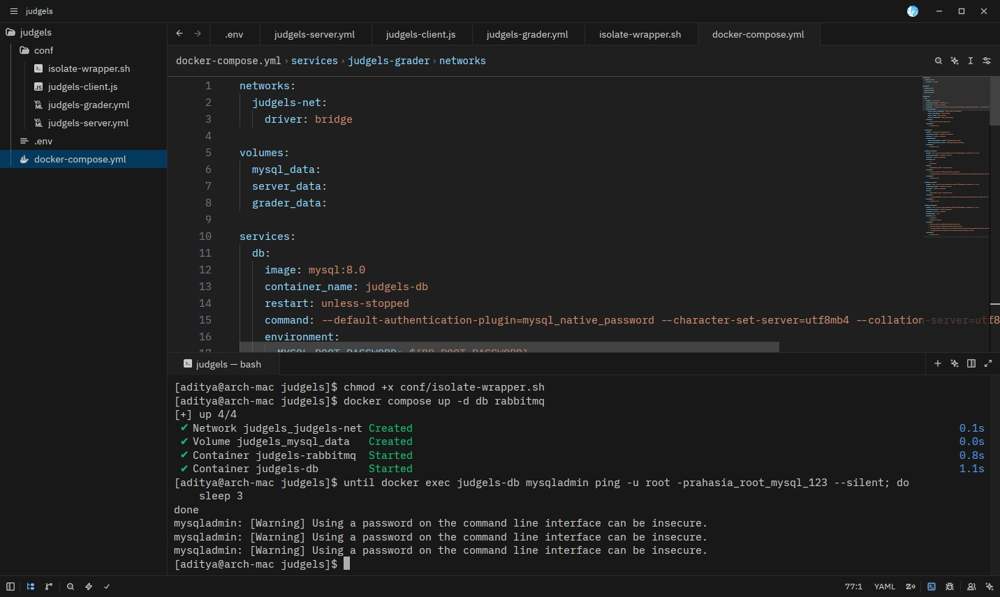

11. Setelah MySQL selesai inisialisasi dan berstatus *alive*, baru deh kita jalankan proses migrasi database untuk membuat 171 tabel:
    ```bash
    $ docker compose run --rm judgels-server db migrate
    ```

    Tunggu sampai muncul laporan `Total change sets: 171` dan `Liquibase: Update has been successful`:

    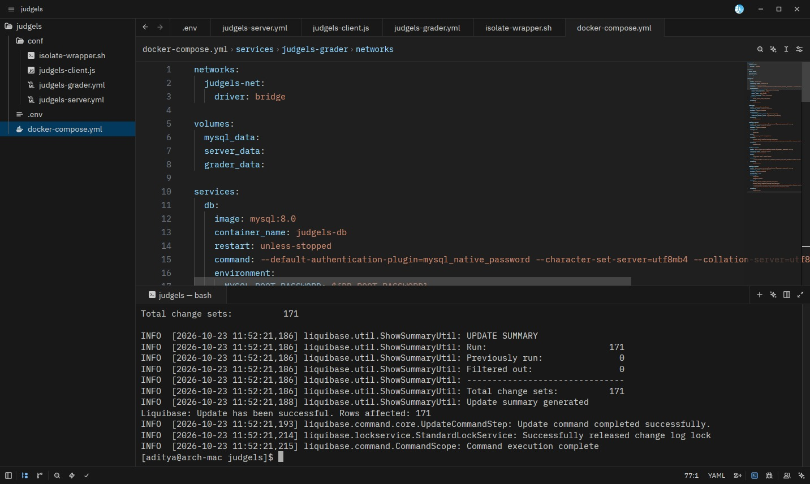

12. Setelah database siap dan migrasi sukses, jalankan seluruh kontainer Judgels lainnya (Server, Client, dan Grader):
    ```bash
    $ docker compose up -d
    ```

    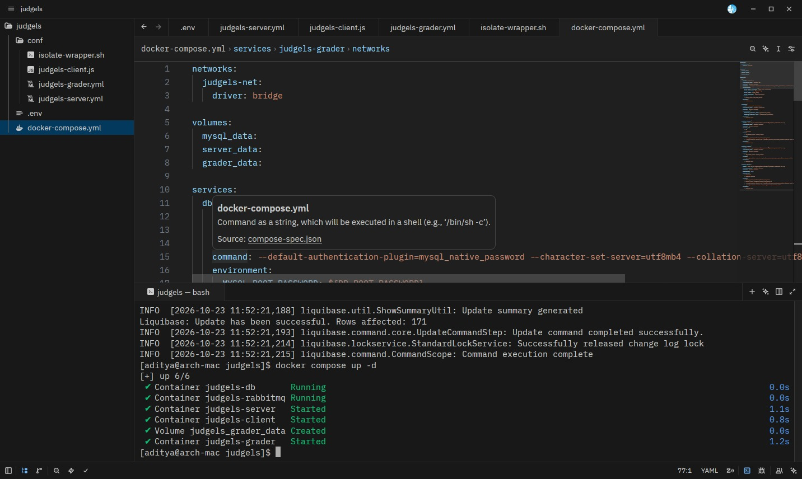

13. Konfigurasikan hak kepemilikan folder data dan pasang `isolate-wrapper` ke dalam kontainer grader agar sistem penilaian dapat berjalan:
    ```bash
    $ docker exec -u 0 judgels-server chown -R judgels:nogroup /judgels/server/var/data
    $ docker exec judgels-grader cp /judgels/isolate/bin/isolate /judgels/isolate/bin/isolate-real
    $ docker exec judgels-grader cp /conf/isolate-wrapper.sh /judgels/isolate/bin/isolate
    $ docker exec judgels-grader chmod +x /judgels/isolate/bin/isolate
    $ docker restart judgels-grader
    ```

    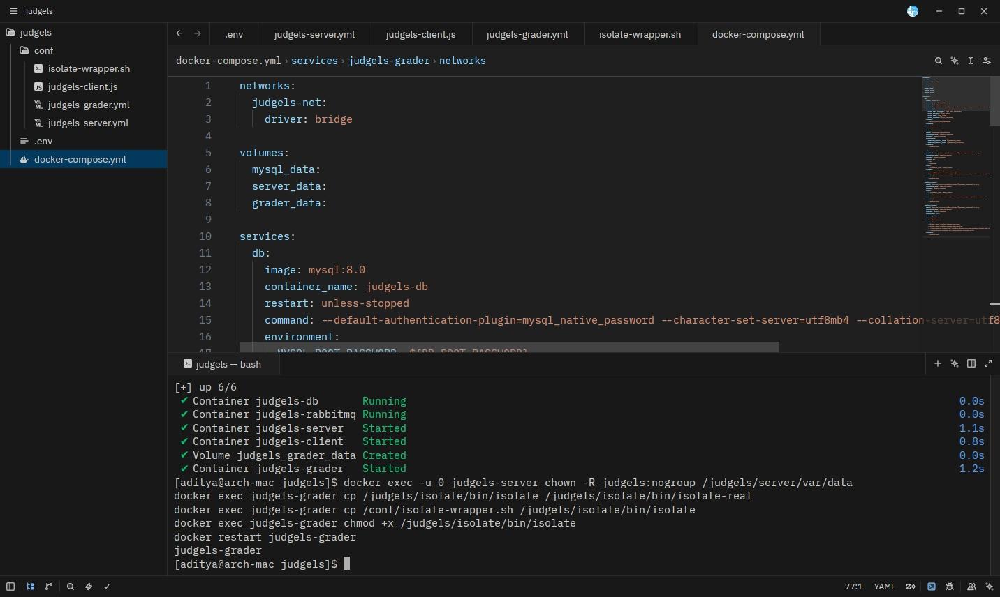

14. Uji instalasi lokal kalian dengan membuka browser:
    - Buka antarmuka peserta di `http://localhost:5000`

      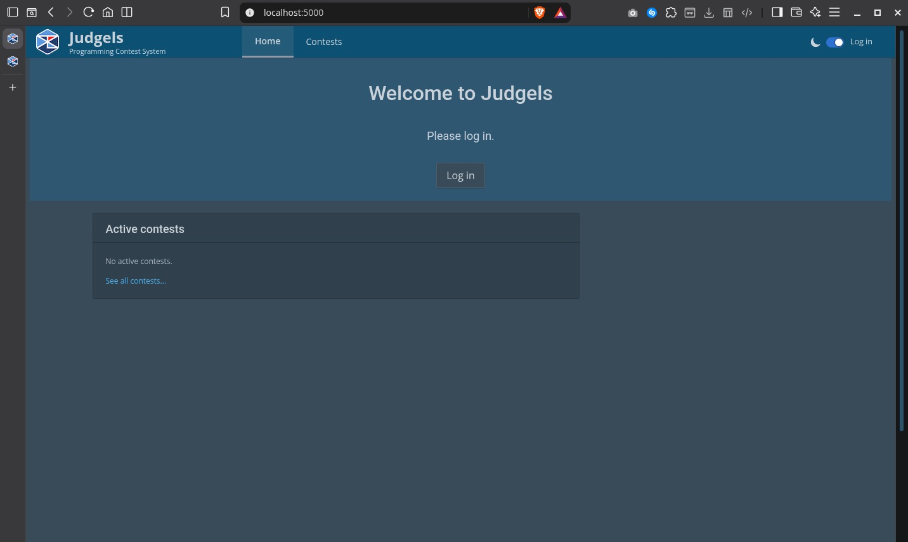

    - Buka antarmuka administrasi di `http://localhost:9101/login`

      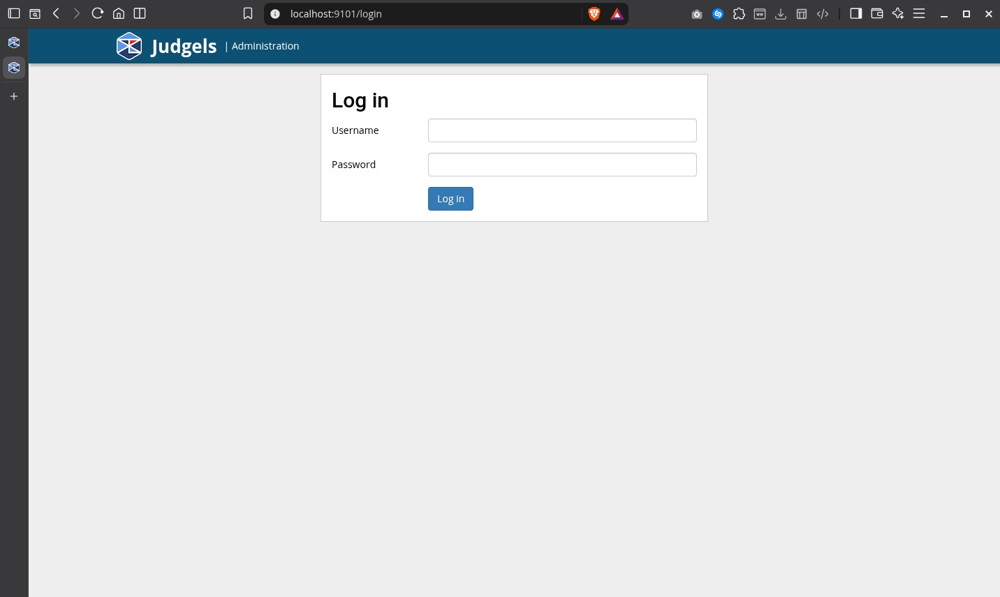

---

### 2. Backup Data Judgels Lokal & Migrasi (Push) ke Server VPS
[`^ kembali ke atas ^`](#)

Kalau kalian sudah mencoba membuat soal, test case, akun peserta, atau kontes di komputer lokal dan ingin memindahkan seluruh data tersebut ke server VPS tanpa perlu repot setup ulang dari nol, kalian bisa mengikuti langkah backup dan push berikut:

1. Lakukan backup (*dump*) database MySQL lokal ke file `database.sql`:
    ```bash
    $ docker exec judgels-db mysqldump -u root -prahasia_root_mysql_123 judgels > database.sql
    ```

    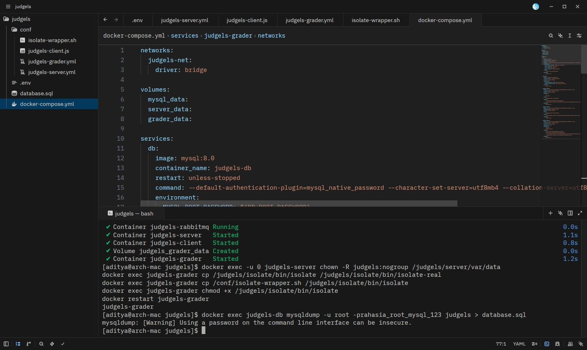

2. Salin (*backup*) seluruh direktori data server lokal (yang berisi file soal, test case, dan submission):
    ```bash
    $ docker cp judgels-server:/judgels/server/var/data ./server_data_backup
    ```

    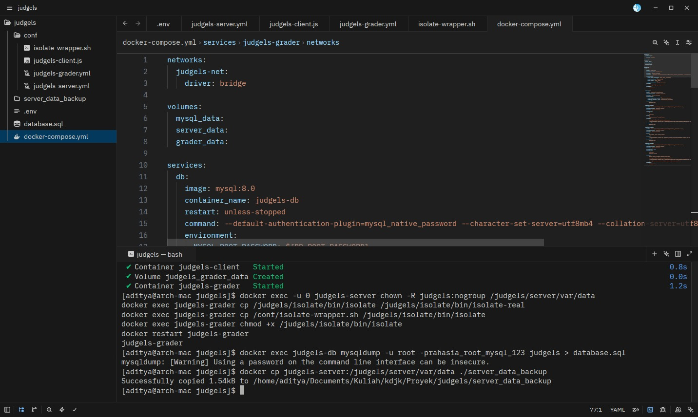

3. Kirimkan seluruh folder proyek `judgels` beserta file backup dari komputer lokal ke server VPS kalian menggunakan perintah `scp`:
    ```bash
    $ scp -r /path/ke/folder/judgels <username>@<IP_VPS>:~/
    ```
    *(Ganti `/path/ke/folder/judgels` dengan path folder proyek di komputer lokal kalian, serta ganti `<username>` dan `<IP_VPS>` sesuai dengan akun dan IP publik server VPS kalian).*

    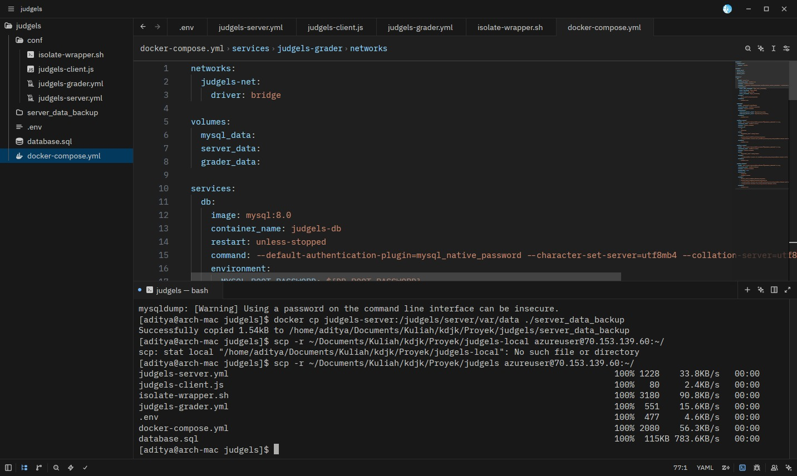

4. Masuk ke dalam server VPS melalui SSH:
    ```bash
    $ ssh <username>@<IP_VPS>
    ```

    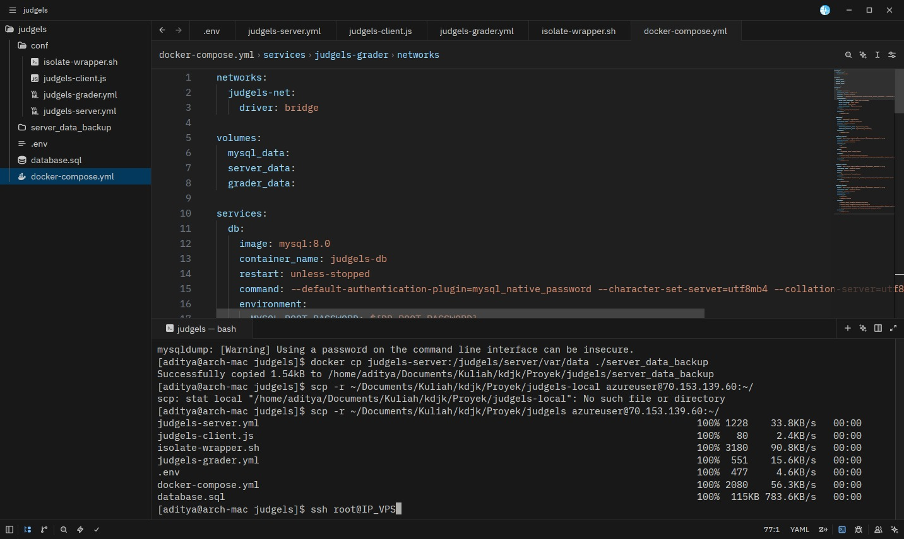
    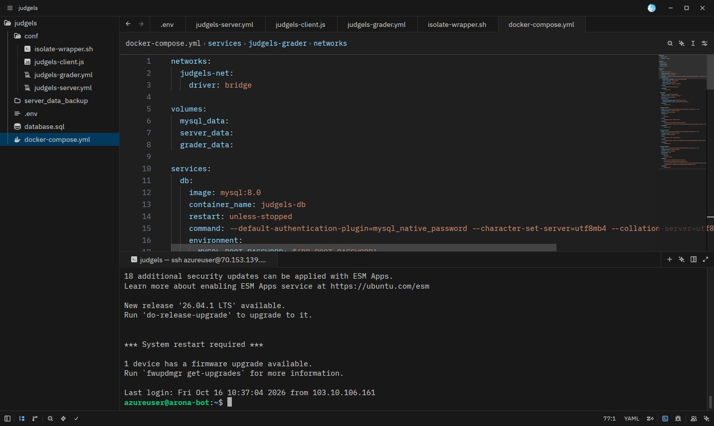

5. Pindah ke direktori `judgels` yang telah diunggah di server VPS:
    ```bash
    $ cd judgels
    ```

    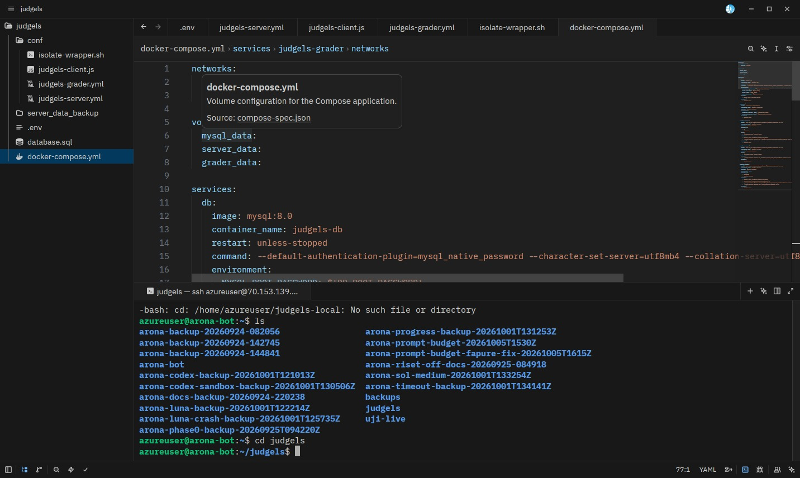

6. Sesuaikan konfigurasi `apiUrl` pada `conf/judgels-client.js` agar menggunakan alamat IP publik VPS kalian:
    ```bash
    $ sed -i 's/localhost/<IP_VPS>/g' conf/judgels-client.js
    ```
    *(Catatan: ganti `<IP_VPS>` dengan alamat IP publik server VPS kalian. Pastikan formatnya murni IP address atau domain ya, jangan menyertakan username SSH).*

    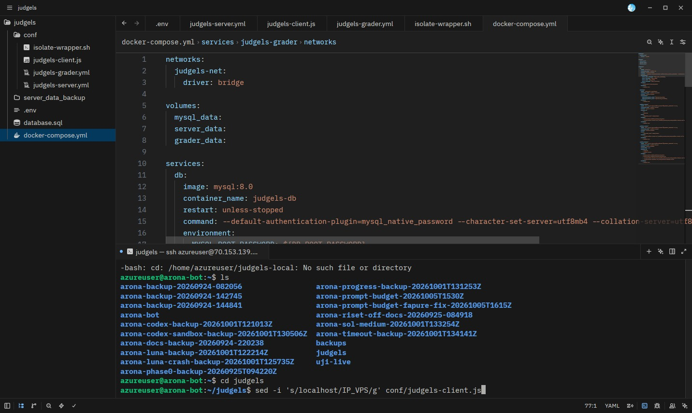

7. Pastikan port `5000` dan `9101` di server VPS belum terpakai oleh proses lain:
    ```bash
    $ sudo ss -tulpn | grep -E ':(5000|9101)'
    ```

    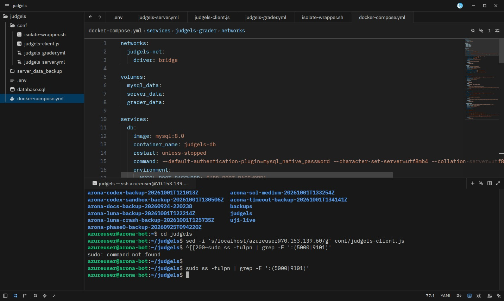

8. Jalankan kontainer database `db` dan `rabbitmq` di server VPS:
    ```bash
    $ docker compose up -d db rabbitmq
    ```

    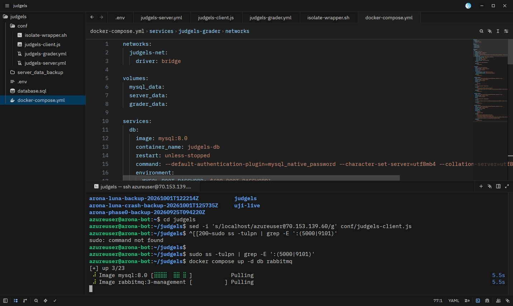

9. Tunggu hingga MySQL di VPS selesai inisialisasi dan siap (*alive*):
    ```bash
    $ until docker exec judgels-db mysqladmin ping -u root -prahasia_root_mysql_123 --silent; do
        sleep 3
    done
    ```

    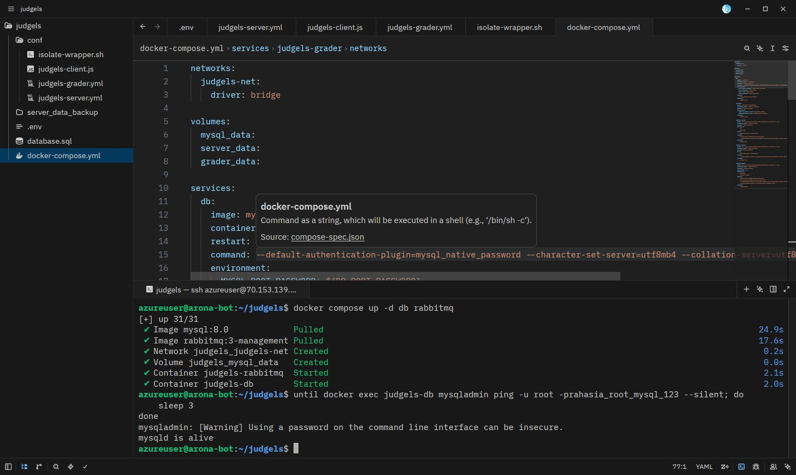

10. Restore database dari file backup `database.sql` yang kita bawa dari lokal:
    ```bash
    $ docker exec -i judgels-db mysql -u root -prahasia_root_mysql_123 judgels < database.sql
    ```
    *(Dengan cara ini, kita tidak perlu menjalankan `db migrate` lagi karena seluruh 171 tabel beserta data soal dan akun superadmin langsung masuk otomatis).*

    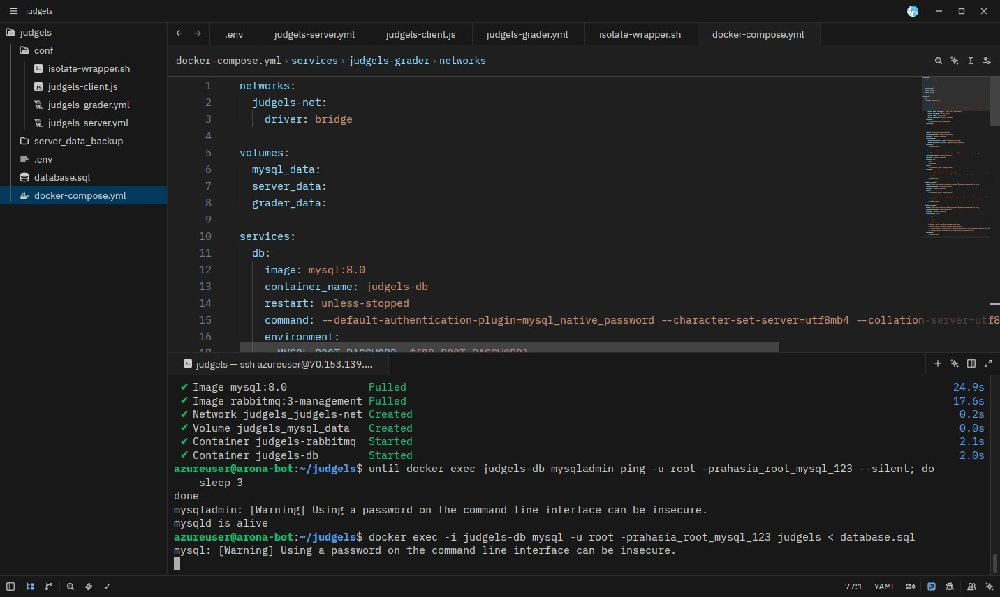

11. Jalankan seluruh layanan kontainer lainnya di server VPS:
    ```bash
    $ docker compose up -d
    ```

    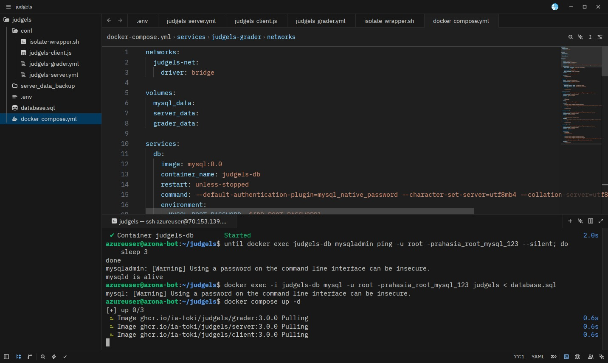
    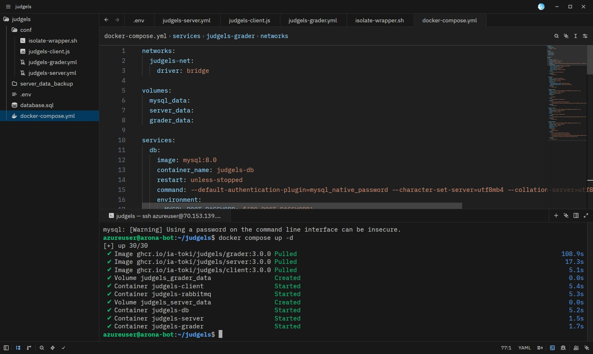

12. Pulihkan folder data server dan siapkan `isolate-wrapper` pada grader di VPS:
    ```bash
    $ docker cp ./server_data_backup/. judgels-server:/judgels/server/var/data/
    $ docker exec -u 0 judgels-server chown -R judgels:nogroup /judgels/server/var/data
    $ docker exec judgels-grader cp /judgels/isolate/bin/isolate /judgels/isolate/bin/isolate-real
    $ docker exec judgels-grader cp /conf/isolate-wrapper.sh /judgels/isolate/bin/isolate
    $ docker exec judgels-grader chmod +x /judgels/isolate/bin/isolate
    $ docker restart judgels-server judgels-grader
    ```

    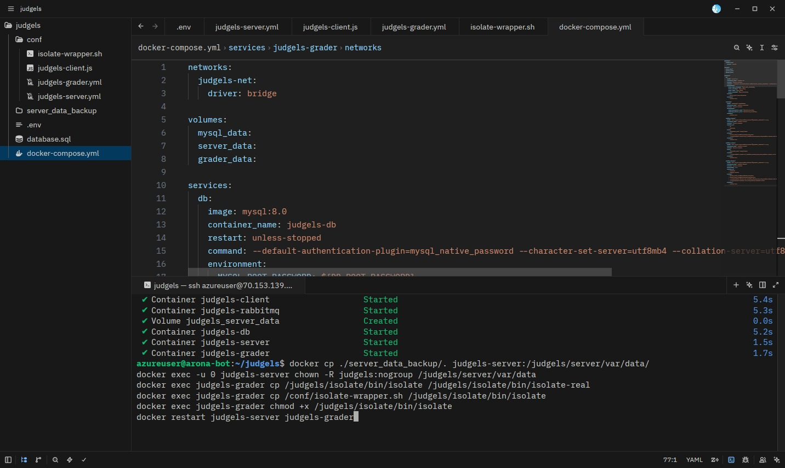
    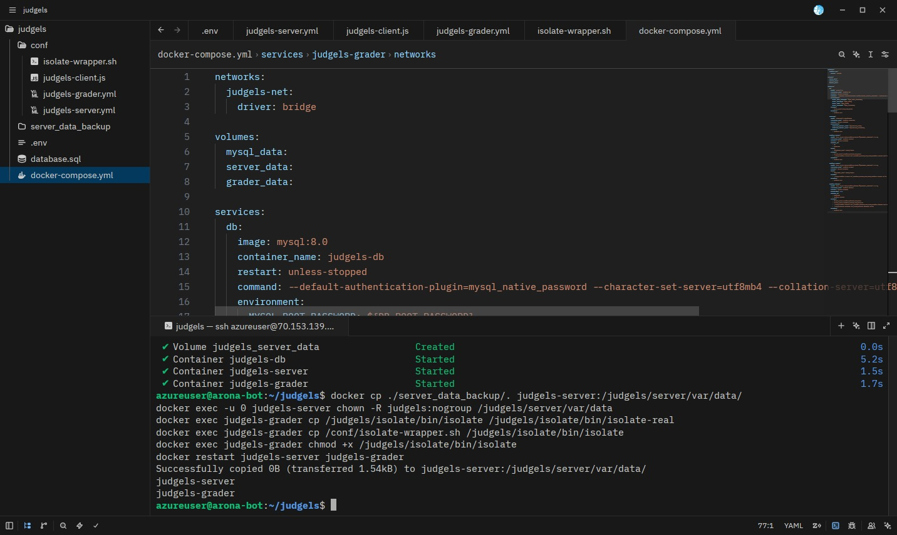

13. Buka alamat IP VPS di browser untuk memastikan data berhasil dipindahkan:
    - Web Peserta: `http://<IP_VPS>:5000`

      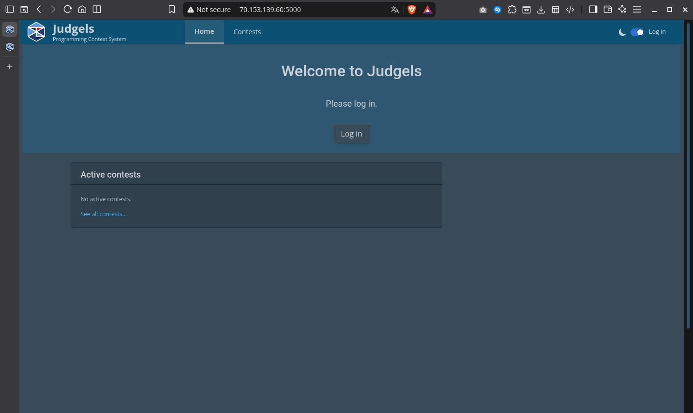

    - Web Administrasi: `http://<IP_VPS>:9101/login`

      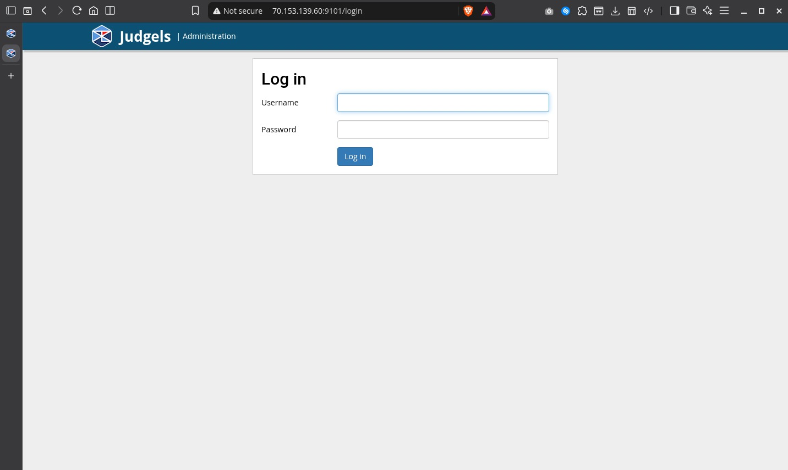

---

### 3. Konfigurasi Domain & HTTPS (SSL Let's Encrypt)
[`^ kembali ke atas ^`](#)

Jika kalian sudah memiliki domain sendiri dan ingin Judgels dapat diakses secara profesional melalui protokol aman HTTPS (port 443 standar tanpa perlu mengekspos port 5000 dan 9101 ke publik), berikut adalah tata cara konfigurasinya menggunakan Nginx Reverse Proxy dan Certbot:

1. Buat 3 DNS A Record pada panel manajemen DNS domain kalian (misalnya DewaBiz atau Cloudflare) yang semuanya mengarah ke alamat IP server (contoh IP server: `103.160.213.105`):
   - `cp-judgels.web.id` → `103.160.213.105` (Antarmuka Web Peserta)
   - `api.cp-judgels.web.id` → `103.160.213.105` (API Server)
   - `admin.cp-judgels.web.id` → `103.160.213.105` (Antarmuka Admin)

2. Buka dan buat file konfigurasi *Virtual Host* Nginx baru di server VPS:
    ```bash
    $ sudo nano /etc/nginx/sites-available/judgels
    ```

    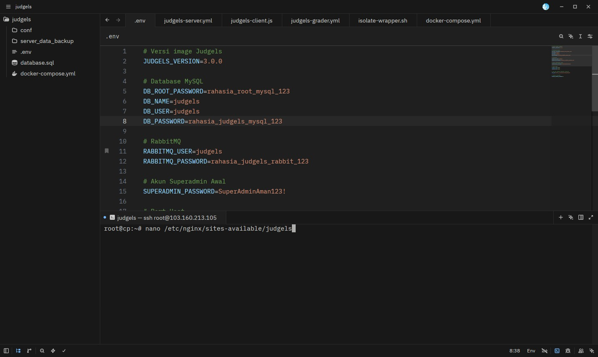

3. Masukkan konfigurasi reverse proxy berikut untuk mengarahkan masing-masing subdomain ke port kontainer yang sesuai:

    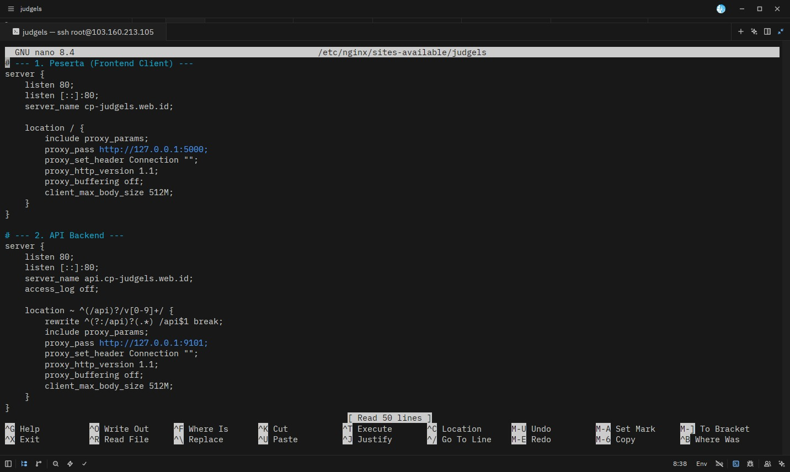

    ```nginx
    # --- 1. Peserta (Frontend Client) ---
    server {
        listen 80;
        listen [::]:80;
        server_name cp-judgels.web.id;

        location / {
            include proxy_params;
            proxy_pass http://127.0.0.1:5000;
            proxy_set_header Connection "";
            proxy_http_version 1.1;
            proxy_buffering off;
            client_max_body_size 512M;
        }
    }

    # --- 2. API Backend ---
    server {
        listen 80;
        listen [::]:80;
        server_name api.cp-judgels.web.id;
        access_log off;

        location ~ ^(/api)?/v[0-9]+/ {
            rewrite ^(?:/api)?(.*) /api$1 break;
            include proxy_params;
            proxy_pass http://127.0.0.1:9101;
            proxy_set_header Connection "";
            proxy_http_version 1.1;
            proxy_buffering off;
            client_max_body_size 512M;
        }
    }

    # --- 3. Antarmuka Admin Backend ---
    server {
        listen 80;
        listen [::]:80;
        server_name admin.cp-judgels.web.id;
        access_log off;

        location / {
            include proxy_params;
            proxy_pass http://127.0.0.1:9101;
            proxy_set_header Connection "";
            proxy_http_version 1.1;
            proxy_buffering off;
            client_max_body_size 512M;
        }
    }
    ```

4. Buat symlink ke `sites-enabled`, test sintaks konfigurasi, dan reload Nginx:
    ```bash
    $ sudo ln -sf /etc/nginx/sites-available/judgels /etc/nginx/sites-enabled/
    $ sudo nginx -t
    $ sudo systemctl reload nginx
    ```

    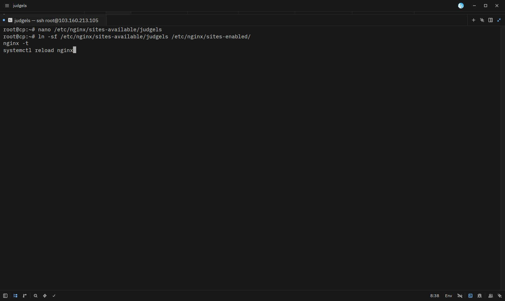
    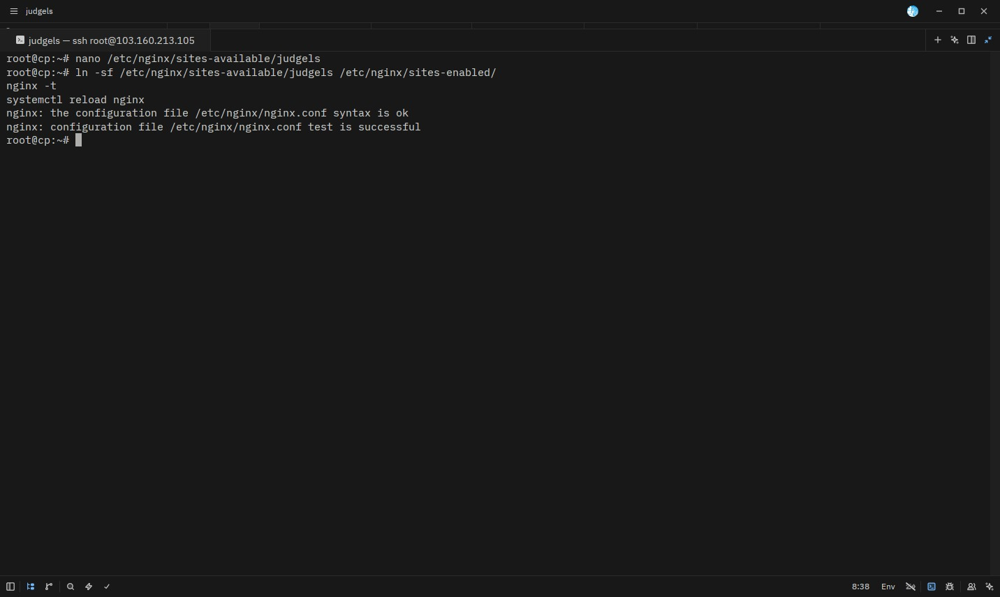

5. Pasang sertifikat SSL gratis dari Let's Encrypt menggunakan Certbot:
    ```bash
    $ sudo certbot --nginx -d cp-judgels.web.id -d api.cp-judgels.web.id -d admin.cp-judgels.web.id
    ```

    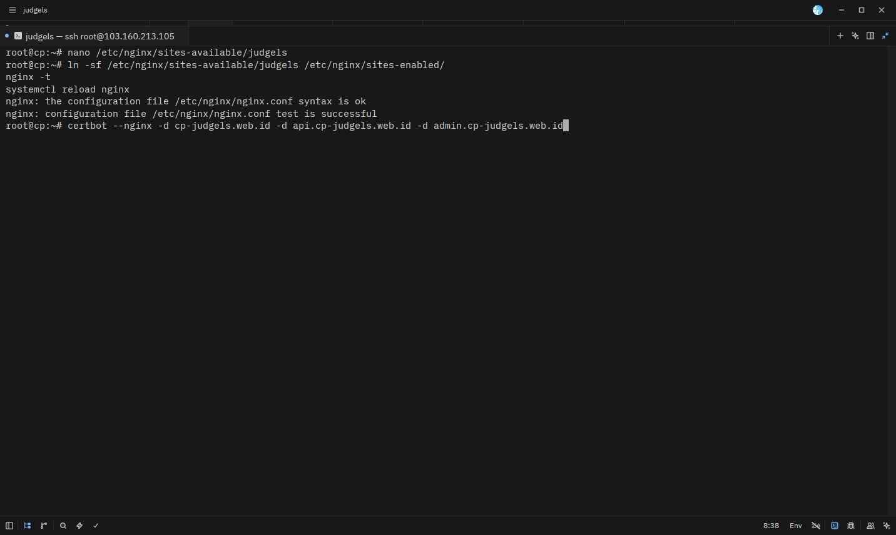

    *(Jika sertifikat sudah pernah dibuat sebelumnya pada server ini, pilih opsi `1: Attempt to reinstall this existing certificate`)*. Certbot akan otomatis memperbarui blok server Nginx dengan konfigurasi SSL dan redirect otomatis HTTP ke HTTPS:

    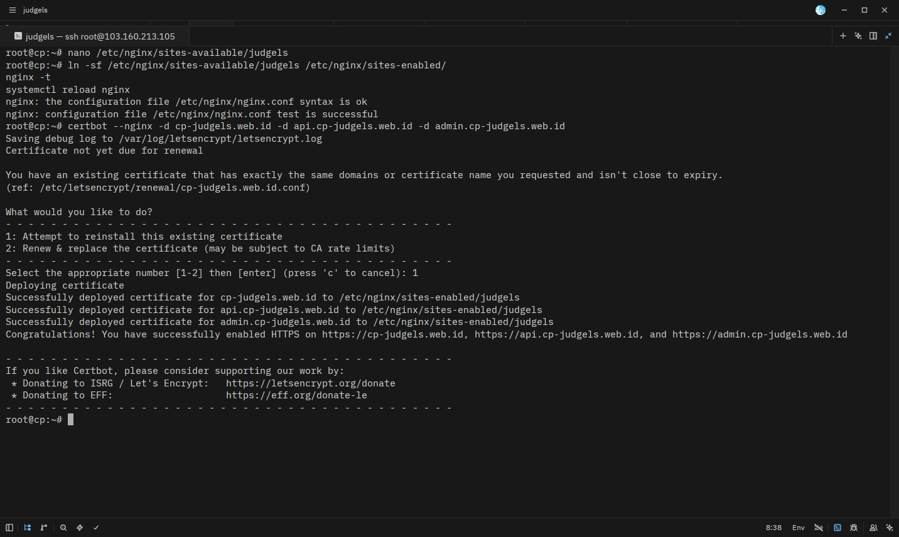

6. Masuk ke direktori Judgels di server dan sesuaikan file `conf/judgels-client.js`:
    ```bash
    $ cd /opt/judgels
    $ nano conf/judgels-client.js
    ```

    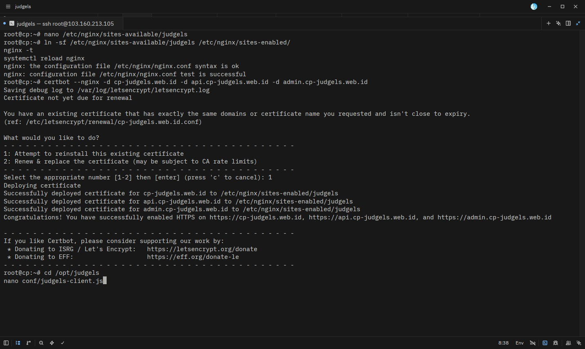

    Ubah nilai `apiUrl` agar menggunakan protokol HTTPS dan domain API:
    ```javascript
    window.conf = {
      mode: 'JUDGELS',
      apiUrl: 'https://api.cp-judgels.web.id/v2',
    };
    ```

    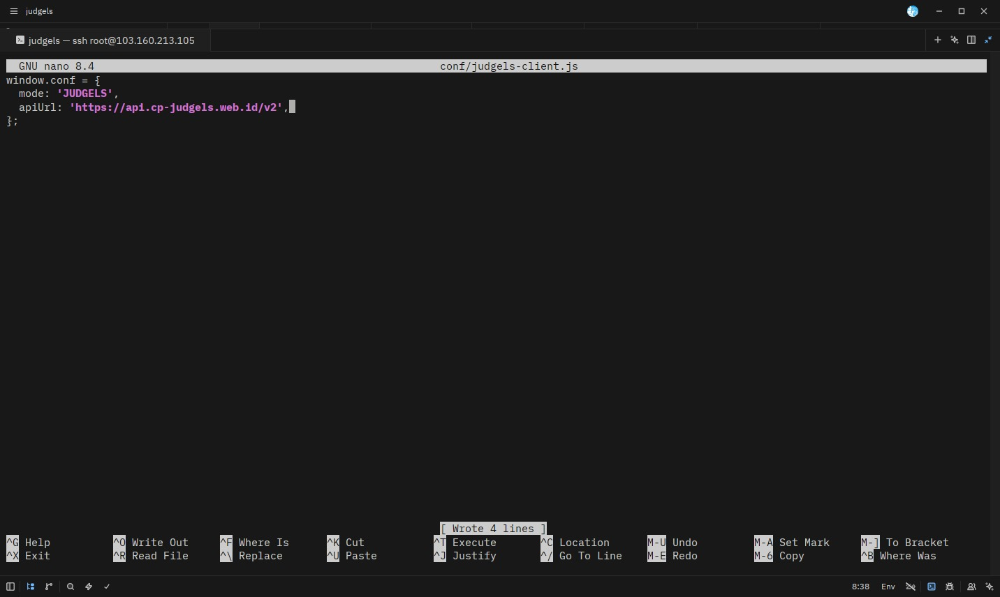

7. Mulai ulang kontainer client Judgels agar perubahan konfigurasi diterapkan:
    ```bash
    $ docker compose restart judgels-client
    ```

    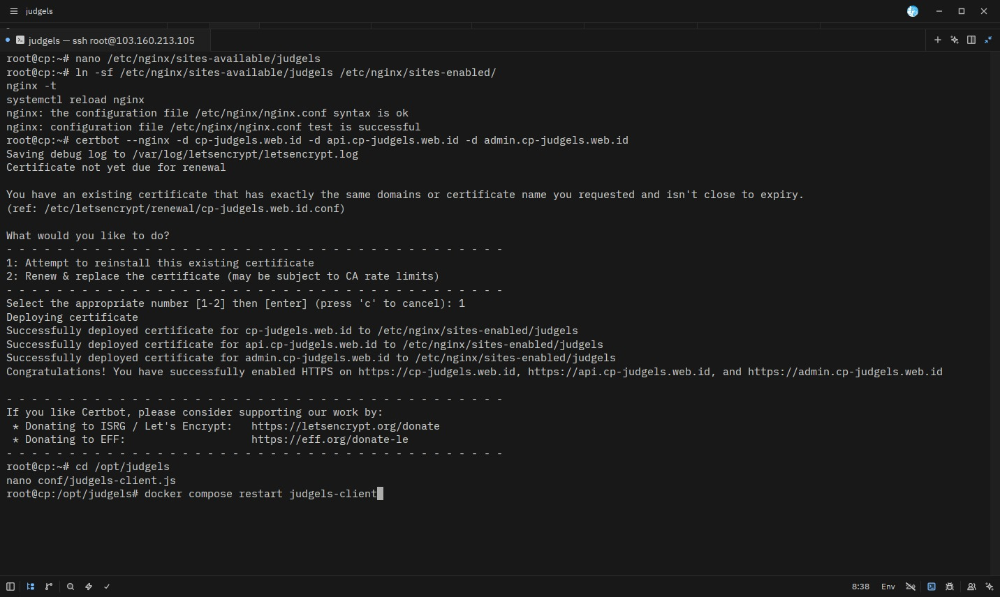

8. Selesai! Sekarang kalian dapat mengakses Judgels secara aman dengan HTTPS melalui domain kalian:
   - Antarmuka Peserta: `https://cp-judgels.web.id`
   - Antarmuka Administrasi: `https://admin.cp-judgels.web.id`
   - Endpoint API: `https://api.cp-judgels.web.id/v2/user-web/config`

---

# Maintenance
[`^ kembali ke atas ^`](#)

Berbeda dengan aplikasi statis, [**Judgels**](https://www.google.com/search?q=https%3A%2F%2Fjudgels.toki.id%2Fdocs%2Fdeployment%2Fconcepts%2F) menyimpan data kontes, akun pengguna, soal, dan hasil penilaian di dalam database **MySQL** (`judgels`), sedangkan file submission kode peserta (*submission files*), *test case*, serta foto profil disimpan pada disk lokal (`/opt/judgels/server/var/data/`). Oleh karena itu, prosedur pemeliharaan mencakup backup database dan file data, pembersihan log, serta pemantauan layanan dan queue penjurian.

### 1. Backup Database MySQL, Berkas Data, dan Konfigurasi (Mingguan)

Buat skrip `~/backup-judgels.sh` pada Core VM untuk backup database MySQL sekaligus file data dan konfigurasi aplikasi. Baca `DB_PASSWORD` dari `/opt/judgels/.env` dan jangan menyalin nilainya ke repositori:

```
#!/bin/bash
BACKUP_DIR="$HOME/backup-judgels"
DATE=$(date +%F)
DB_USER="judgels"
DB_PASS="$(sed -n 's/^DB_PASSWORD=//p' /opt/judgels/.env)"
DB_NAME="judgels"

mkdir -p "$BACKUP_DIR"

# 1. Backup database MySQL
docker exec judgels-mysql mysqldump -u "$DB_USER" -p"$DB_PASS" --single-transaction --quick "$DB_NAME" \
  | gzip > "$BACKUP_DIR/judgels-db-$DATE.sql.gz"

# 2. Backup direktori data (submissions, test cases, avatars) dan konfigurasi
sudo tar -czf "$BACKUP_DIR/judgels-data-$DATE.tar.gz" \
  /opt/judgels/server/var/data \
  /opt/judgels/server/var/conf \
  /opt/judgels/client/var/conf \
  /opt/judgels/.env \
  /opt/judgels/nginx-judgels.conf

# 3. Hapus arsip backup yang lebih lama dari 28 hari
find "$BACKUP_DIR" -name 'judgels-*.gz' -mtime +28 -delete

```

Beri permission execute pada script:

```
chmod +x ~/backup-judgels.sh

```

Jadwalkan backup otomatis setiap hari Minggu pukul 02.00 dini hari menggunakan `crontab -e`:

```
0 2 * * 0 /home/<username>/backup-judgels.sh

```

Untuk restore data dari cadangan saat terjadi kendala:

```
# Pulihkan database MySQL
DB_PASS="$(sed -n 's/^DB_PASSWORD=//p' /opt/judgels/.env)"
gunzip < ~/backup-judgels/judgels-db-<tanggal>.sql.gz | docker exec -i judgels-mysql mysql -u judgels -p"$DB_PASS" judgels

# Pulihkan file data dan konfigurasi, lalu restart kontainer
sudo tar -xzf ~/backup-judgels/judgels-data-<tanggal>.tar.gz -C /
docker compose -f /opt/judgels/docker-compose.yml restart judgels-server judgels-client

```

### 2. Pembersihan Log dan Image Kontainer (Harian)

Judgels Server menulis log operasional di `/opt/judgels/server/var/log/`. Gunakan `sudo crontab -e` untuk menjadwalkan pembersihan *systemd journal* (menyimpan 14 hari terakhir), penghapusan log aplikasi yang berusia lebih dari 14 hari, serta pembersihan *image* Docker tak terpakai setiap hari pukul 03.00:

```
0 3 * * * /usr/bin/journalctl --vacuum-time=14d && /usr/bin/find /opt/judgels/*/var/log/ -type f -mtime +14 -delete && /usr/bin/docker image prune -f

```

### 3. Pemantauan Layanan dan Antrean Penilaian

Periksa kesehatan kontainer Docker, layanan pendukung (MySQL & Nginx), dan queue RabbitMQ secara berkala:

1. **Pemeriksaan Kontainer dan Log Aplikasi:**
   Pastikan kontainer `judgels-client`, `judgels-server`, `judgels-mysql`, dan `rabbitmq` berstatus *Up*:

   ```
   docker ps
   docker logs --tail=100 -f judgels-server
   
   ```

2. **Pemeriksaan Layanan Nginx:**

   ```
   sudo systemctl status nginx
   
   ```

3. **Pemantauan Antrean Penilaian (RabbitMQ):**

   * **RabbitMQ Management UI:** Jika port management dipublikasikan oleh `docker-compose.yml`, akses UI sesuai port yang didefinisikan Compose. Kredensial RabbitMQ ada di `/opt/judgels/.env`.

### 4. Pembaruan Sistem dan Upgrade Versi Judgels

Perbarui paket sistem operasi Debian pada server secara berkala:

```
sudo apt update && sudo apt upgrade -y

```

Jika muncul pesan *System restart required*, jalankan `sudo reboot`. Layanan Docker dan Nginx beserta kontainer Judgels akan aktif kembali secara otomatis setelah server menyala.

Apabila ingin memperbarui Judgels ke versi rilis baru dari [GitHub Releases Judgels](https://www.google.com/search?q=https%3A%2F%2Fgithub.com%2Fia-toki%2Fjudgels%2Freleases), ubah `JUDGELS_VERSION` pada `/opt/judgels/.env` (atau jalankan kembali `setup.sh` dengan versi baru), lalu tarik image dan jalankan ulang Compose:

```
cd /opt/judgels
docker compose pull
docker compose up -d
```

# Otomatisasi (opsional)
[`^ kembali ke atas ^`](#)

Jika kalian tidak ingin menjalankan setiap perintah instalasi, konfigurasi, maupun backup secara manual satu per satu lewat terminal, kami sudah menyiapkan skrip shell otomasi praktis yang bisa langsung kalian gunakan:

### 1. Skrip Otomatisasi Instalasi & Setup (`setup.sh`)
Skrip [setup.sh](./setup.sh) akan otomatis mengurus seluruh tahapan persiapan Judgels di server kalian tanpa perlu ribet:
- Membuat direktori kerja di `/opt/judgels`.
- Menghasilkan password acak yang aman untuk MySQL, RabbitMQ, dan akun superadmin di file `.env`.
- Mengonfigurasi `judgels-server.yml`, `judgels-client.js`, dan membuat file reverse proxy Nginx (`nginx-judgels.conf`).
- Menjalankan seluruh kontainer Docker secara otomatis.

Cara menjalankannya gampang banget:
```bash
$ chmod +x setup.sh
$ sudo ./setup.sh cp-judgels.web.id 3.0.0
```
*(Kalian bisa ganti `cp-judgels.web.id` dengan domain milik kalian sendiri).*

### 2. Skrip Otomatisasi Backup Data (`backup.sh`)
Untuk menjaga keamanan data kontes, soal, dan akun pengguna dari hal-hal yang tidak diinginkan, kalian bisa menjalankan skrip [backup.sh](./backup.sh) kapan saja (atau dijadwalkan mingguan via `crontab`):
- Melakukan *dump* database MySQL (`database.sql`).
- Menyalin seluruh folder file data server (soal, test case, dan submission).
- Menyalin konfigurasi `.env`.
- Mengompres semuanya menjadi satu file arsip `.tar.gz` yang rapi dengan timestamp otomatis di folder `~/backup-judgels/`.

Cara menjalankannya:
```bash
$ chmod +x backup.sh
$ sudo ./backup.sh
```

### 3. Skrip Otomatisasi Restore Data (`restore.sh`)
Nah, semisal server mengalami kendala atau kalian ingin mengembalikan data dari hasil backup sebelumnya, cukup gunakan skrip [restore.sh](./restore.sh):
- Otomatis mengekstrak arsip cadangan.
- Mengimpor kembali seluruh tabel database MySQL.
- Memulihkan seluruh file data server dan memperbaiki hak aksesnya.
- Memulai ulang kontainer server Judgels.

Cara menjalankannya:
```bash
$ chmod +x restore.sh
$ sudo ./restore.sh ~/backup-judgels/judgels-backup-YYYY-MM-DD_HHMMSS.tar.gz
```

---

# Cara Pemakaian
[`^ kembali ke atas ^`](#)

Setelah seluruh infrastruktur Judgels berhasil dipasang dan berjalan di VPS, berikut adalah panduan alur pemakaian lengkap yang kami bagi menjadi dua peran utama: **Pembuat Soal (Problem Setter / Juri)** yang mengelola soal dan berkas uji coba, serta **Peserta Kompetisi (Contestant)** yang mengirimkan kode solusi dan memeriksa status penilaian otomatis.

---

### 1. Alur Pembuat Soal (Problem Setter / Juri)
[`^ kembali ke atas ^`](#)

1. Buka antarmuka administrasi di `https://admin.cp-judgels.web.id/login`, masukkan username `superadmin` beserta kata sandi yang telah dibuat:

    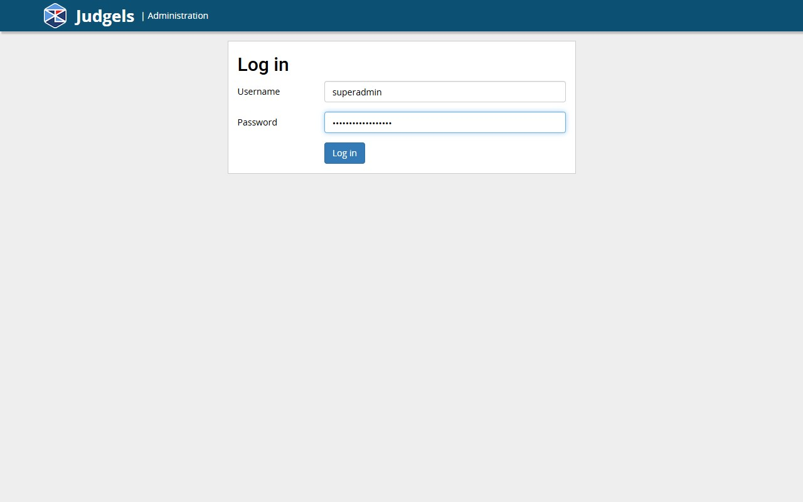

2. Setelah berhasil masuk ke dashboard, pilih menu **Problems** di bilah navigasi kiri untuk melihat daftar repositori soal, lalu klik tombol **New problem** di pojok kanan atas:

    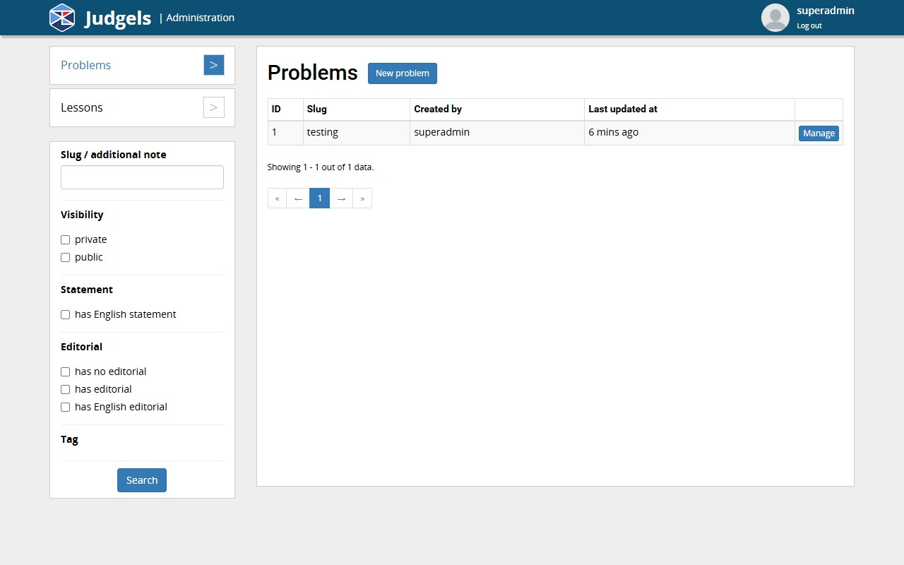

3. Masukkan identitas soal berupa *Slug* (contoh: `boxes-of-apples`), catatan pengantar, serta bahasa awal soal (*English* atau *Indonesian*), kemudian klik tombol **Create**:

    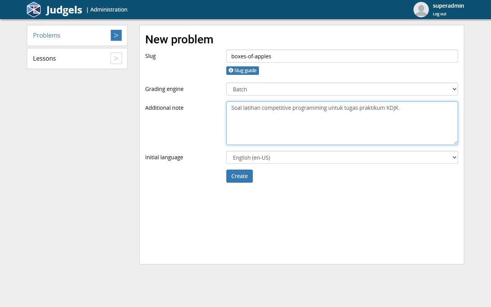

4. Masuk ke tab **Statements** untuk menyusun narasi soal, batas waktu/memori, format masukan dan keluaran, contoh uji coba (*sample cases*), serta rumus matematika berbasis LaTeX:

    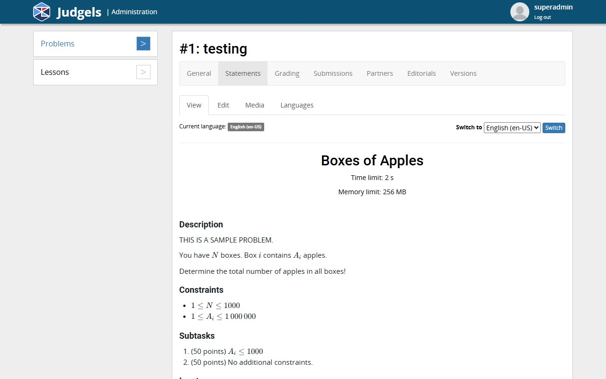

5. Pindah ke tab **Grading** > **Config** untuk mengatur batasan sumber daya eksekusi, seperti batas waktu CPU (*Time limit: 2000 ms*) dan alokasi memori (*Memory limit: 262144 KB* / 256 MB):

    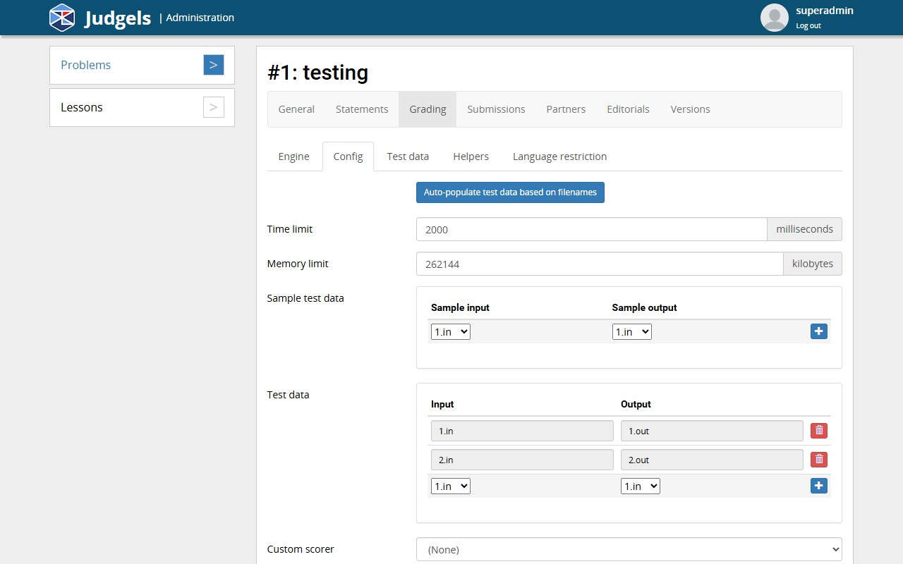

6. Buka tab **Test data** untuk mengunggah berkas uji coba masukan (`.in`) dan kunci jawaban benar (`.out` / `.ans`), baik diunggah per berkas maupun langsung dalam satu arsip `.zip`:

    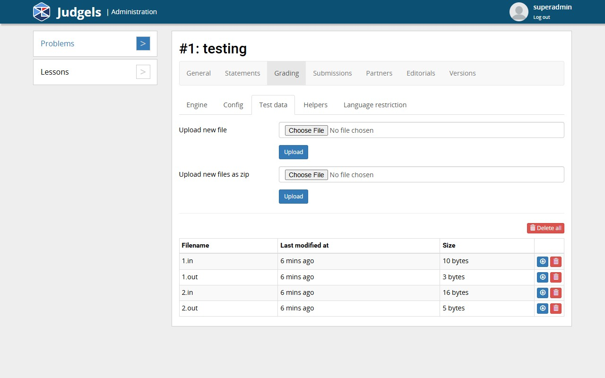

7. Kembali ke tab **Config**, gunakan fitur **Auto-populate test data based on filenames** agar sistem otomatis memetakan pasangan berkas `1.in` ke `1.out`, `2.in` ke `2.out`, lalu simpan perubahan dengan menekan tombol **Update**:

    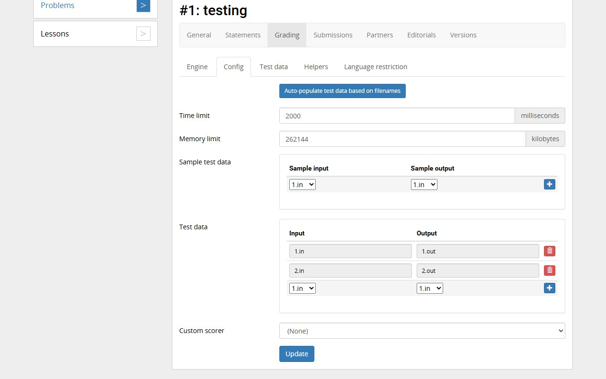

---

### 2. Alur Peserta Kompetisi (Contestant / Pengguna)
[`^ kembali ke atas ^`](#)

1. Peserta mengakses antarmuka kompetisi publik melalui alamat `https://cp-judgels.web.id/login` dan masuk menggunakan akun kontestan (`peserta`):

    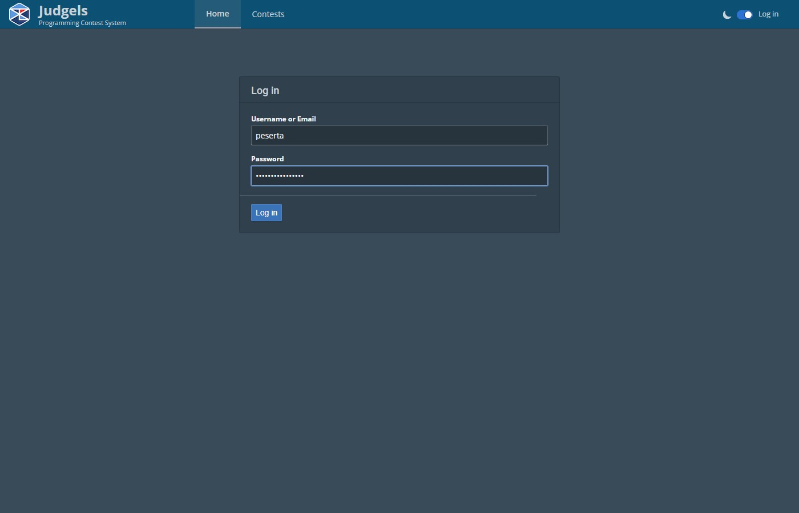

2. Setelah berhasil masuk ke beranda kompetisi, peserta membuka kontes yang sedang aktif (**Simulasi Kontes KDJK 2026**) lalu memilih soal **A. Boxes of Apples** untuk membaca deskripsi permasalahan, batasan waktu/memori (*Time limit: 2s, Memory limit: 256 MB*), rumus matematika berbasis LaTeX, subtask penilaian, serta format masukan dan contoh keluaran (*sample test cases*):

    

3. Gulir ke bagian bawah lembar soal pada formulir **Submit solution**. Peserta memilih bahasa pemrograman yang digunakan (misalnya **C++20**), menempelkan kode program solusi pada editor bawaan atau mengunggah berkas solusi, kemudian menekan tombol **Submit**:

    

4. **Kasus 1: Jawaban Benar (Accepted / AC 100)**  
   Jika program menghasilkan keluaran yang benar di seluruh test case sesuai batas waktu dan memori, sistem mengembalikan status hijau **Accepted** dengan skor penuh 100/100 dan centang hijau pada seluruh pengujian:

    

5. **Kasus 2: Jawaban Salah (Wrong Answer / WA 0)**  
   Jika keluaran kode program peserta berbeda dari file kunci jawaban (`.out`), sistem memberikan status merah **Wrong Answer** dengan nilai 0:

    

6. **Kasus 3: Kesalahan Eksekusi (Runtime Error / RTE 0)**  
   Jika kode program peserta mengalami crash saat dieksekusi di dalam sandbox Isolate (misalnya pembagian dengan nol atau segmentation fault), sistem menandainya dengan status oranye **Runtime Error**:

    

7. **Pemantauan Terpadu di Halaman Submissions**  
   Seluruh riwayat submisi peserta, perolehan nilai, waktu pengiriman, serta status masing-masing submission (Accepted, Wrong Answer, maupun Runtime Error) dapat dipantau langsung melalui menu **Submissions** pada bilah navigasi kontes:

    

---

# Pembahasan
[`^ kembali ke atas ^`](#)

### Pendapat Tentang Judgels
Judgels adalah platform sistem kontes pemrograman dan *online judge* open-source yang dikembangkan oleh Ikatan Alumni TOKI (IA-TOKI). Platform ini digunakan secara aktif pada ekosistem olimpiade informatika di Indonesia seperti TLX, OSN, hingga ajang internasional seperti APIO.

Dari segi arsitektur, Judgels menggunakan pemisahan komponen layanan: frontend berbasis React SPA, backend menggunakan Java Dropwizard, RabbitMQ untuk antrean penilaian kode, serta sandbox *Isolate* di Linux agar eksekusi kode peserta berjalan aman dan terisolasi. Fitur bawaannya sudah mencakup bank soal (*problem repository*), pengaturan berkas test case, klarifikasi, papan skor (*scoreboard*), dan pengelolaan peran panitia kontes.

---

### Kelebihan
Beberapa kelebihan Judgels yang kami temukan selama pengujian:
- **Mendukung Dua Format Kontes Sekaligus**: Bisa menjalankan kontes format **IOI** (skor bertingkat per subtask dengan nilai 0-100) maupun **ICPC** (sistem biner Accepted/Rejected dengan penalti waktu).
- **Pilihan Jenis Soal Lengkap**: Mendukung tipe soal standar I/O (*batch*), interaktif (komunikasi dua arah), *output-only*, hingga *functional/grader* (peserta cukup melengkapi fungsi).
- **Mekanisme Penilaian Fleksibel**: Menyediakan penilaian berbasis subtask berbobot, validator khusus (*custom checker*), dan *custom grader*.
- **Keamanan Eksekusi Kode**: Menggunakan sandbox *Isolate* untuk membatasi pemakaian memori, batas waktu CPU, system call berbahaya, dan memblokir akses jaringan ilegal dari kode peserta.
- **Arsitektur Skalabel**: Pemisahan worker penilaian lewat RabbitMQ memudahkan penambahan mesin *grader* baru jika jumlah submisi peserta meningkat.
- **Manajemen Soal Terstruktur**: Tersedia fitur versi soal, pengelompokan file test case otomatis, preview deskripsi soal langsung, serta pembagian hak akses pengguna berbasis peran (*roles*).

---

### Kekurangan
Beberapa kekurangan dan tantangan teknis saat melakukan deployment Judgels:
- **Konsumsi Resource Server Cukup Tinggi**: Karena backend berjalan di atas JVM dan membutuhkan MySQL serta RabbitMQ, server membutuhkan RAM minimal 4 GB agar seluruh kontainer stabil tanpa kendala out-of-memory.
- **Perlu Penyesuaian Sandbox Isolate di Docker**: Sandbox Isolate bawaan dirancang untuk cgroup v1. Ketika dijalankan di dalam kontainer Docker pada distro Linux modern dengan cgroup v2, dibutuhkan script wrapper khusus agar eksekusi tidak mengalami internal error.
- **Konfigurasi URL Client SPA Sangat Ketat**: Frontend React SPA berjalan di browser sisi klien, sehingga parameter `apiUrl` pada `judgels-client.js` wajib dikonfigurasi tepat ke domain HTTPS atau IP publik backend agar tidak terhalang kebijakan CORS.
- **Dokumentasi Deployment Mandiri Masih Minim**: Panduan resmi bawaan lebih banyak berfokus pada playbook Ansible untuk Ubuntu bare-metal, sehingga setup menggunakan Docker Compose perlu dirangkai dan diuji urutan migrasi databasenya secara mandiri.

---

### Perbandingan dengan Aplikasi Sejenis
Jika dibandingkan dengan platform contest management dan online judge sejenis seperti **DOMjudge**, **CMS (Contest Management System)**, dan **DMOJ**, Judgels memiliki karakteristik tersendiri:

| Aspek | Judgels | DOMjudge | CMS (Contest Management System) | DMOJ |
|---|---|---|---|---|
| **Pengembang** | Ikatan Alumni TOKI | Komunitas DOMjudge | Komunitas CMS | Komunitas DMOJ |
| **Konsep Utama** | Sistem pengelolaan soal dan kontes pemrograman lengkap | Sistem penjurian kontes pemrograman, terutama fokus ICPC | Sistem terdistribusi olimpiade pemrograman, fokus IOI | Platform online judge, arsip soal latihan, dan kontes |
| **Model Deployment** | *Self-hosted*; Docker Compose dan skrip `setup.sh` | *Self-hosted*; server kontes dan satu atau lebih *judgehost* | *Self-hosted* di Linux; tersedia opsi Docker | *Self-hosted*; situs dan server penjurian dipasang sebagai komponen terpisah |
| **Jenis Soal** | *Batch*, interaktif, *output-only*, dan *functional/grader*; mendukung subtask | Penjurian otomatis dengan bahasa dan validator yang dapat dikonfigurasi | Beragam jenis tugas, termasuk *batch*, *output-only*, dan interaktif | Soal berbasis input/output, interaktif, dan *signature-graded*; mendukung validator khusus |
| **Format Kontes** | IOI dan ICPC; mendukung kontes virtual | ICPC dan penilaian parsial bergaya IOI | Beragam format tugas dan penilaian; dirancang untuk kebutuhan IOI | ICPC, IOI, AtCoder, dan ECOO; mendukung partisipasi virtual |
| **Fitur Pengelolaan** | Versi soal, pengumuman, klarifikasi, papan skor, serta peran pengelola dan pengawas | Antarmuka juri dan tim, klarifikasi, papan skor, serta penjurian ulang | Antarmuka administrasi, impor kontes dan soal, serta layanan papan skor | Arsip soal, editorial, papan skor, rating opsional, dan pengelolaan pengguna |
| **Skalabilitas** | Skalabilitas horizontal worker grader melalui RabbitMQ | Kapasitas penjurian dapat ditambah dengan *judgehost* | Arsitektur terdistribusi dengan layanan dan pekerja penjurian | Mendukung banyak server penjurian (*judge servers*) |
| **Kebutuhan Pengelolaan** | Administrator menyiapkan deployment Docker / server dan database | Administrator menyiapkan server kontes, database, dan *judgehost* | Administrator menyiapkan layanan CMS, PostgreSQL, dan lingkungan penjurian | Administrator menyiapkan situs web, database, dan server penjurian |
| **Biaya Perangkat Lunak** | Open Source (GPL-2.0); bebas biaya lisensi | Open Source (GPL-2.0); bebas biaya lisensi | Open Source (GPL-3.0); bebas biaya lisensi | Open Source (AGPL-3.0); bebas biaya lisensi |

**Ringkasan Perbandingan:**
- **Judgels vs DOMjudge**: DOMjudge fokus pada kontes tim bergaya ICPC dengan antarmuka juri dan balon penanda, namun kurang fleksibel untuk tipe soal interaktif atau subtask bertingkat yang umum di olimpiade sains. Sebaliknya, Judgels unggul dalam fleksibilitas jenis soal dan manajemen repositori soal.
- **Judgels vs CMS**: CMS (*Contest Management System*) adalah sistem resmi yang dipakai pada International Olympiad in Informatics (IOI). CMS sangat andal untuk format IOI murni, tetapi konfigurasinya berbasis file Python/PostgreSQL yang cukup rumit dan tidak dirancang untuk kontes tim ICPC seperti Judgels.
- **Judgels vs DMOJ**: DMOJ lebih ditujukan sebagai platform arsip soal dan latihan harian publik (mirip Codeforces atau SPOJ) dengan rating pengguna, sedangkan Judgels dirancang fokus untuk kelancaran sesi kontes resmi yang terjadwal.

---

# Referensi
[`^ kembali ke atas ^`](#)

1. https://github.com/ia-toki/judgels

2. https://judgels.toki.id/docs/introduction/

3. https://judgels.toki.id/docs/deployment/concepts/

4. https://judgels.toki.id/docs/deployment/installation/

5. https://judgels.toki.id/docs/deployment/cheatsheet/
